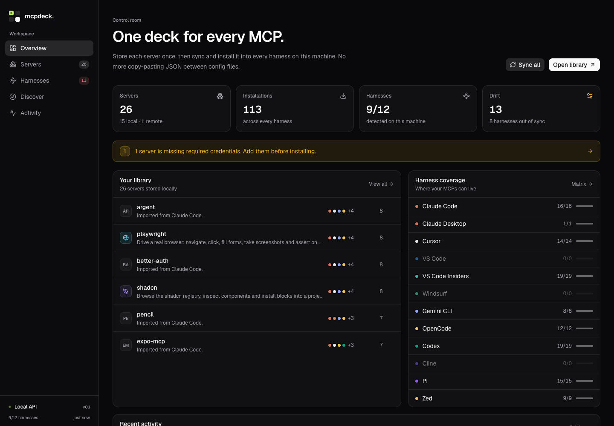

# mcpdeck

One deck for every MCP server. mcpdeck keeps a single, encrypted library of the
MCP servers on your machine, shows which harnesses have them installed, and
writes them into each harness's config with a back-up first.

It is **local-first**: the API binds to `127.0.0.1`, the database lives on disk,
and nothing is sent anywhere. No account, no cloud, no telemetry.



## What it does

- **Library** — every server is stored once with its command, args, URL, env
  keys, headers and tags. Existing configs are imported on first run.
- **Sync** — scans Claude Code, Claude Desktop, Cursor, VS Code,
  VS Code Insiders, Windsurf, Gemini CLI, OpenCode, Codex, Cline, Pi and Zed on
  startup. New config entries are imported, existing entries are linked, and
  removed entries are reported. The same package under different names (for
  example `playwright` and `microsoft/playwright-mcp`) is collapsed into one
  library server.
- **Drift detection** — compares the library against each config and classifies
  entries as in sync, drifted, missing from the config, or missing from the
  library.
- **Install / uninstall** — flip a switch in the harness matrix. Every write is
  atomic and keeps a timestamped backup.
- **Push & repair** — push the library version of a server to every harness, or
  repair all drift for one harness / the whole machine.
- **Secrets** — env values and headers are encrypted with AES-256-GCM before
  they touch SQLite. The UI only ever shows key names, with an explicit reveal
  action.
- **Discover** — a curated 23-server catalog for common local and hosted MCPs.
- **Activity** — an append-only event log of scans, installs, edits, deletes and
  errors.
- **Export** — a JSON snapshot of the library without secret values.

## Stack

| Layer | Choice |
| --- | --- |
| API | Bun + Hono + tRPC v11, plus REST routes for automation |
| Database | SQLite via `bun:sqlite`, Drizzle ORM, raw startup migrations |
| Web | Next.js 16 App Router, React 19, Tailwind CSS v4, Framer Motion |
| UI | shadcn/ui on Radix, Lucide icons, Sonner toasts |
| Validation | Zod |
| Config I/O | `jsonc-parser` for JSON/JSONC, `smol-toml` for Codex TOML |
| Checks | `tsc`, `next build`, bash smoke test, Playwright screenshots |

### Deliberate omissions

The brief allowed picking the pieces that were needed. A few were not:

- **MapLibre + OpenStreetMap** — there is no geographic data in an MCP manager.
- **FastAPI** — there is no model inference or AI service in v1; the Bun API is
  the only backend.
- **Rust** — no CPU-sensitive work. SQLite writes and AES-GCM are more than fast
  enough in Bun's native runtime.

## Requirements

- [Bun](https://bun.sh) 1.3 or newer
- Node.js 20.9+ on `PATH` (Next.js 16 needs it)
- macOS or Linux. Windows paths are implemented but not exercised in CI.

## Quickstart

```bash
git clone <this-repo> mcpdeck
cd mcpdeck
cp .env.example .env
bun install
bun run dev
```

Open **http://localhost:3100**. The API listens on **http://127.0.0.1:4000**.

`bun run dev` starts both processes in watch mode. The web app talks to the API
through `NEXT_PUBLIC_API_URL` (default `http://127.0.0.1:4000`). Root `.env` is
loaded by `bun run dev`; if you start an app on its own, export the variables or
put a `.env` in that app's directory.

To run a production build:

```bash
bun run build
bun run start                       # API on :4000
bun run --cwd apps/web start        # web on :3100
```

The first API start performs a scan. Nothing is written to harness configs
during a scan; writes only happen when you install, uninstall, push, repair or
delete.

## Supported harnesses

Paths are the defaults on macOS. On Linux, `Library/Application Support` paths
become `$XDG_CONFIG_HOME` (usually `~/.config`), and OpenCode/Zed respect
`XDG_CONFIG_HOME` on every platform. On Windows, App Support paths become
`%APPDATA%`.

| Harness | Config | Format | Notes |
| --- | --- | --- | --- |
| Claude Code | `~/.claude.json` | `mcpServers` | User-scope entries |
| Claude Desktop | `~/Library/Application Support/Claude/claude_desktop_config.json` | `mcpServers` | Remote servers are bridged through `npx mcp-remote`; restart after changes |
| Cursor | `~/.cursor/mcp.json` | `mcpServers` | Explicit stdio/http `type` fields |
| VS Code | `~/Library/Application Support/Code/User/mcp.json` | `servers` | Adds the required `type` field |
| VS Code Insiders | `~/Library/Application Support/Code - Insiders/User/mcp.json` | `servers` | Separate Insiders profile; same format as VS Code |
| Windsurf | `~/.codeium/windsurf/mcp_config.json` | `mcpServers` | Remote servers use `serverUrl`; also checks `windsurf-next` |
| Gemini CLI | `~/.gemini/settings.json` | `mcpServers` | Remote HTTP servers use `httpUrl` |
| OpenCode | `~/.config/opencode/opencode.jsonc` | `mcp` | Prefers `.jsonc` when both forms exist; local/remote entries and `enabled` flag |
| Codex | `~/.codex/config.toml` | `[mcp_servers.*]` | TOML is reformatted on write (see below) |
| Cline | `~/Library/Application Support/Code/User/globalStorage/saoudrizwan.claude-dev/settings/cline_mcp_settings.json` | `mcpServers` | Remote servers use `type: "streamableHttp"`; also checks Insiders and `~/.cline` |
| Pi | `~/.pi/agent/mcp.json` | `mcpServers` | Global Pi config; project-local `.pi/mcp.json` is not managed |
| Zed | `~/.config/zed/settings.json` | `context_servers` | JSONC; flat `command`/`args`/`env` or `url` entries |

A harness is reported as detected when its install directory or config file
exists. A missing config file is not an error: installing creates it.

OpenCode accepts `opencode.json` and `opencode.jsonc`. mcpdeck scans and writes
the first one that exists, preferring `opencode.jsonc`, and never edits both
forms in the same directory.

### Claude Desktop remote servers

Claude Desktop only launches stdio servers from `claude_desktop_config.json`;
it rejects `url`/`type` entries. When you install or push a remote server into
Claude Desktop, mcpdeck writes an `npx mcp-remote@latest` stdio bridge instead.
Header values are passed through environment variables referenced as
`${MCPDECK_HEADER_*}` so credentials do not appear in the process arguments.

The bridge requires Node.js 18+ and downloads `mcp-remote` on first launch.
Scanning recognizes existing `mcp-remote` bridges and maps them back to the
remote server in the library. Restart Claude Desktop after config changes.

## How a write works

1. Re-read the current config, preserving its original text.
2. Update only the transport fields of each managed entry. Unknown fields such
   as `autoApprove`, `timeout`, `trust`, `enabled` and extension settings are
   retained, and entries mcpdeck cannot parse are left untouched. JSON and JSONC
   files go through `jsonc-parser`'s edit API, so comments, key order and most
   formatting survive.
3. Copy the previous file to `.data/backups/<harness>/<timestamp>--<name>`.
4. Write to a temporary file with mode `0600`, then rename it over the target.
   The last 25 backups per harness are kept.

**Codex TOML caveat:** `smol-toml` parses and re-serializes the whole file. The
values are preserved and a backup is written, but comments and custom ordering
in `~/.codex/config.toml` are lost. If you keep comments there, prefer editing
Codex through mcpdeck rather than hand-editing after an install.

## Data and security

Everything lives in `.data/` at the repo root by default:

```text
.data/
├── mcpdeck.db          # SQLite database
├── key                 # AES-256-GCM master key, mode 0600
└── backups/<harness>/  # timestamped config backups
```

The data directory is created with mode `0700`, and the key is never sent over
the API. Env values and headers are encrypted at rest. `GET /api/servers` and
the normal tRPC list endpoints return **key names only**; values are available
only through the explicit reveal mutation, which the UI gates behind a click.

The API listens on loopback only. REST automation hooks can additionally be
protected with `MCPDECK_TOKEN`; when it is set, `POST /api/hooks/*` requires
`Authorization: Bearer <token>`. Other read routes are not token-protected and
should not be exposed beyond localhost. CORS allows only localhost origins.

To start over, stop the API and delete `.data/`. The next start rescans harness
configs. This also deletes backups and any library-only servers you created.

## HTTP API

REST for scripts and integrations; tRPC for the web client.

| Method | Route | Purpose |
| --- | --- | --- |
| GET | `/api/health` | Liveness, data dir, per-harness counts |
| GET | `/api/overview` | Dashboard counters |
| GET | `/api/servers?q=&harness=&transport=` | Library with installs |
| GET | `/api/harnesses` | Harness metadata, paths and counts |
| GET | `/api/drift` | Drift for every harness |
| GET | `/api/events?limit=` | Recent activity |
| GET | `/api/registry?q=` | Curated catalog |
| GET | `/api/export` | Library export, secrets excluded |
| POST | `/api/hooks/sync` | Scan all, or one with `{ "harnessId": "cursor" }` |
| POST | `/api/hooks/install` | Install `{ "serverId", "harnessId" }` |
| POST | `/api/hooks/uninstall` | Uninstall `{ "serverId", "harnessId" }` |
| ALL | `/trpc/*` | tRPC endpoint used by the web UI |

Example:

```bash
SERVER_ID=$(curl -s http://127.0.0.1:4000/api/servers \
  | jq -r '.[] | select(.slug == "context7") | .id')

curl -s -X POST http://127.0.0.1:4000/api/hooks/install \
  -H 'content-type: application/json' \
  ${MCPDECK_TOKEN:+-H "authorization: Bearer $MCPDECK_TOKEN"} \
  -d "{\"serverId\":\"$SERVER_ID\",\"harnessId\":\"cursor\"}"
```

## Scripts

| Command | What it does |
| --- | --- |
| `bun run dev` | API + web in watch mode |
| `bun run build` | Production Next.js build |
| `bun run typecheck` | TypeScript for API and web |
| `bun run smoke` | End-to-end config-write test in a temp `HOME` |
| `bun run shot` | Screenshot each page with Chrome (macOS path) |

The smoke test never touches your real harness configs. It creates disposable
Cursor, Zed, OpenCode, Codex, Pi, Gemini CLI, Cline, Windsurf, VS Code Insiders
and Claude Desktop files, then verifies each harness's entry shape, JSONC
comments, preserved harness-specific settings, alias dedupe, idempotent rescans,
existing entries, TOML output, uninstall behavior and backups. It prints the
temporary home so you can inspect the result; remove it when done.

## Project layout

```text
apps/
├── api/
│   └── src/
│       ├── index.ts              Hono server, REST and tRPC mounting
│       ├── db/                   SQLite schema and startup migrations
│       ├── lib/
│       │   ├── crypto.ts         AES-256-GCM helpers
│       │   ├── harness-config.ts adapters, JSONC/TOML I/O, backups
│       │   ├── paths.ts          harness config discovery
│       │   ├── store.ts          scan, diff, install, repair, events
│       │   └── registry.ts       curated catalog lookup
│       └── trpc/router.ts        typed API surface
└── web/
    └── src/
        ├── app/                  Overview, Servers, Harnesses, Discover, Activity
        └── components/           sheets, forms, shadcn/ui primitives
packages/
└── shared/                     domain types, harness metadata, curated catalog
scripts/
├── dev.ts                      run both apps
├── shot.ts                     Playwright screenshots
└── smoke.sh                    isolated harness I/O test
```

## Limitations

- **No cloud sync.** "Sync" means reconciling the local library with the local
  harness configs. Move the SQLite file or use `/api/export` to carry state.
- **Restart semantics are up to the harness.** Claude Desktop, VS Code and
  others may need a reload before they notice a config change.
- **Codex TOML comments are not preserved** on write; values and a backup are.
- **Unknown servers are imported generically.** If a config name does not match
  a curated slug, it gets the `General` category and an "Imported from …"
  description. Edit it in the UI to add tags and a better description.
- **URLs are not encrypted.** Env values and headers are encrypted at rest, but
  a URL is stored as-is because it is part of the server identity. Credentials
  embedded in a URL path or query string are therefore visible. Prefer headers
  or env vars for secrets where the server supports them.
- **Windows is untested.** The path logic exists, but atomic rename over an
  existing file and mode bits behave differently there.
- **Push and repair write the library's values.** If the same server uses
  different credentials in different harnesses, pushing or repairing will
  replace the per-harness values with the library copy (after a backup).
  Keep credentials in one place, or avoid repair for that entry.
- **One process per machine.** The API assumes a single writer; there is no
  multi-user or networked mode.
